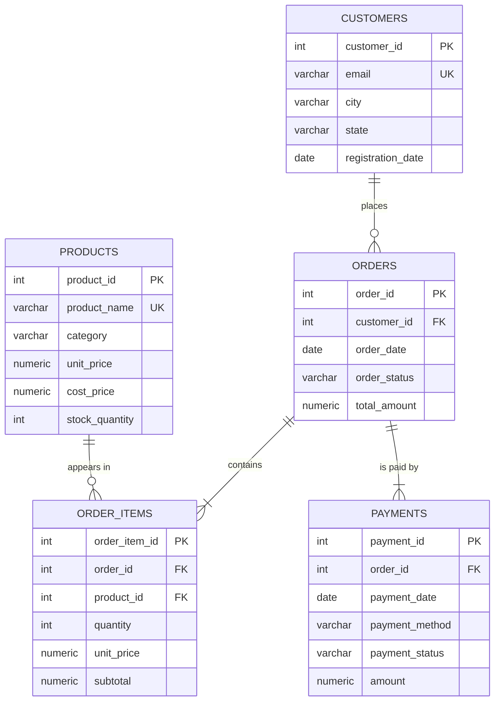

# AI-Powered Business Intelligence & Analytics Platform
### LangGraph · PostgreSQL · Docker · Streamlit · Plotly

An analytics application for a **fictional** Indian online retail store. A business owner can explore the
database, view KPI dashboards and ask questions in plain English. A LangGraph workflow turns each question
into safe, read-only SQL, runs it on PostgreSQL and explains the **actual** results.

> All data is synthetic, generated with a fixed random seed. No real company, employee, customer or client data is used.

---

## 1. Business problem
A small retailer's data (customers, products, orders, payments) is only useful if the owner can get answers
without writing SQL: *Which products drive profit? Which cities matter? Are payments failing?* This
project stores the data correctly (relational model with integrity rules), presents it as dashboards,
and adds a natural-language analyst that cannot change or damage the data.

## 2. Objectives
- Design a normalized 5-table PostgreSQL schema with PK/FK/UNIQUE/CHECK constraints and indexes.
- Generate and load consistent synthetic data (ingestion).
- Build SQL-backed dashboards. Every number comes from a live query.
- Implement a real LangGraph `StateGraph` for natural language → SQL with validation, retries and error handling.
- Containerize everything with Docker Compose.
- Test the database, queries, security and workflow automatically.

## 3. Technology stack
| Layer | Technology |
|---|---|
| Language | Python 3.13 |
| Database | PostgreSQL 16 (`postgres:16-alpine`) |
| DB access | SQLAlchemy 2 + Psycopg 3, Pandas |
| UI / charts | Streamlit 1.66, Plotly |
| AI workflow | LangGraph 1.2 (StateGraph), LangChain (Anthropic or OpenAI chat models) |
| SQL safety | sqlglot (SQL parser) + PostgreSQL role permissions |
| Containers | Docker, Docker Compose |
| Tests | pytest |

## 4. System architecture
```
Browser ──► localhost:8501
             │
┌────────────▼──────────── Docker Compose network ─────────────────────┐
│ app  (python:3.13-slim)                                               │
│   Streamlit pages ─► app/queries.py ─┐                                │
│   AI Analyst ─► LangGraph graph ─────┼─► SQLAlchemy (role analytics_ro│
│                  └─► LLM API (HTTPS) │    read-only, 5 s timeout)     │
│                                      ▼                                │
│ db   (postgres:16-alpine)   business_analytics  ◄── volume pgdata     │
└───────────────────────────────────────────────────────────────────────┘
```
- The app connects as **`analytics_ro`** (SELECT only). The owner account `analytics_admin` is used only by
  the init scripts and `seed_data.py` to create tables and load data.

## 5. Docker architecture
| Item | Value | Why |
|---|---|---|
| Service `db` | official `postgres:16-alpine` | Database server |
| Service `app` | built from `Dockerfile` | Seeds data, then runs Streamlit |
| Network | Compose default network | `app` reaches the DB at hostname **`db`** |
| Volume | `pgdata` → `/var/lib/postgresql/data` | Data survives `docker compose down` / restarts |
| Init scripts | `database/init/` → `/docker-entrypoint-initdb.d` | Schema and read-only role, **first start only** |
| Health checks | `pg_isready` (db), `/_stcore/health` (app) | `app` waits for `db: service_healthy` |
| Ports | `8501:8501` (app), `5433:5432` (db) | Host:container |

**Key Docker terms**
- **Image** is a read-only template (OS + Python + libraries + code). **Container** is a running instance of an image.
- **Docker Compose** defines several containers, their network, volumes and environment in one YAML file.
- **Volume** is storage managed by Docker that lives outside the container, so deleting the container keeps the data.
- **Network**: Compose creates a private network, and each service name works as a hostname there.
- **Port mapping** `HOST:CONTAINER` exposes a container port on your Mac.
- **Environment variables** pass configuration and secrets in at runtime. They come from `.env`, which is never committed.
- **Health check** is a command Docker runs repeatedly to decide whether a container is *healthy*, not just *running*.

## 6–10. Database schema, ERD, tables, relationships


| Table | Rows | Purpose | Key constraints |
|---|---|---|---|
| customers | 120 | Registered customers | PK, `email` UNIQUE + format CHECK |
| products | 24 (6 categories) | Catalogue, price, cost, stock | PK, name UNIQUE, `price > 0`, `cost ≤ price`, `stock ≥ 0` |
| orders | 420 (Apr–Oct 2026) | Order header | PK, FK→customers, status CHECK (6 values) |
| order_items | 870 | Order lines | PK, FK→orders, FK→products, `subtotal = quantity × unit_price`, UNIQUE(order_id, product_id) |
| payments | 463 | Payment attempts | PK, FK→orders, method and status CHECK, `amount > 0` |

**Relationships (all one-to-many):** customer → orders, order → order_items, product → order_items,
order → payments. `order_items` is the junction table that resolves the many-to-many relationship between orders and products.

**Indexes:** PostgreSQL indexes primary keys automatically but not foreign keys, so all FK columns are indexed,
plus `order_date`, `order_status`, `payment_status`, `city`, `category`.

## 11. Normalization
The schema is in **Third Normal Form (3NF)**:
- **1NF:** atomic values with no repeating groups. Each product in an order is its own `order_items` row, not `product1, product2…` columns.
- **2NF / 3NF:** every non-key column depends only on its table's key. Customer city lives in `customers`, not repeated in every order.
- **Deliberate copy:** `order_items.unit_price` stores the *price at time of sale* (historical fact), so later price changes don't rewrite history.
  `orders.total_amount` is a stored total, kept consistent and verified by tests.

## Financial definitions (used identically in dashboard, insights and AI prompts)
| Metric | Definition |
|---|---|
| **Gross order value** | `SUM(subtotal)` over **all** orders (any status): ₹25,60,914 |
| **Revenue** | `SUM(subtotal)` for orders with status `processing`, `shipped`, `delivered`: **₹19,47,750** |
| **Successful payment amount** | `SUM(payments.amount)` where `payment_status='success'`: ₹19,47,750 (reconciles with revenue) |
| **Product cost (COGS)** | `SUM(quantity × products.cost_price)` for revenue orders |
| **Gross profit** | Revenue − COGS |
| **Profit margin** | Gross profit ÷ Revenue |
| **AOV** | Revenue ÷ number of revenue orders |

**Assumptions:** no tax, shipping or discounts. The current `cost_price` applies to past sales. Pending, cancelled and returned orders are
not revenue. **Revenue is never computed by summing payments**, because one order can have a failed *and* a successful
payment row (double-counting risk). Successful payments are used only as a cross-check.
Seed rules: completed orders have exactly one `success` payment (15% preceded by a `failed` attempt), pending → `pending`,
cancelled → `failed`, returned → `refunded`.

## 12. SQL examples
```sql
-- Revenue by city (3-table join)
SELECT c.city, SUM(oi.subtotal) AS revenue
FROM order_items oi
JOIN orders o    ON o.order_id = oi.order_id
JOIN customers c ON c.customer_id = o.customer_id
WHERE o.order_status IN ('processing','shipped','delivered')
GROUP BY c.city ORDER BY revenue DESC;

-- Gross profit and margin by category
SELECT p.category,
       SUM(oi.subtotal) - SUM(oi.quantity * p.cost_price) AS gross_profit,
       ROUND(100 * (SUM(oi.subtotal) - SUM(oi.quantity * p.cost_price)) / SUM(oi.subtotal), 1) AS margin_pct
FROM order_items oi
JOIN orders o   ON o.order_id = oi.order_id
JOIN products p ON p.product_id = oi.product_id
WHERE o.order_status IN ('processing','shipped','delivered')
GROUP BY p.category ORDER BY gross_profit DESC;
```
Dashboard queries use bound parameters (`:start`, `:cities`) and never string-formatting of user input.

## 13 & 15. LangGraph AI workflow
```
START → understand_question ─┬─(off-topic)──────────────────────────────► generate_response → END
                             └► identify_tables → generate_sql → validate_sql
                                                      ▲            ├─ valid ─► execute_sql
                                                      │            ├─ invalid, retries left ─┘(back to generate_sql)
                                                      │            └─ invalid, no retries ─► generate_response
                                         execute_sql ─┼─ DB error, retries left
                                                      ├─ DB error, no retries / 0 rows ─► generate_response
                                                      └─ rows ─► analyze_results ─► generate_response
```
| Node | LLM | Reads → writes |
|---|---|---|
| `understand_question` | ✅ | question → `objective`, `needs_clarification` |
| `identify_tables` | ✅ | objective + **live schema** → `identified_tables`, `relevant_schema` |
| `generate_sql` | ✅ | schema + business rules (+ previous error on retry) → `generated_sql` |
| `validate_sql` | ❌ | `generated_sql` → `validation_status`, `validated_sql` (LIMIT enforced) |
| `execute_sql` | ❌ | `validated_sql` → `query_results`, `row_count` or `error_message` |
| `analyze_results` | ✅ | actual rows → `analysis`, `chart_recommendation` |
| `generate_response` | ❌ | everything → `final_response` (or honest error / "no data") |

- **State:** `AnalystState` (TypedDict) in `app/ai/state.py`, including `user_question, identified_tables, relevant_schema,
  generated_sql, validation_status, query_results, analysis, chart_recommendation, final_response, error_message`,
  plus `retry_count` and `trace`. `trace` has an `operator.add` reducer, so each node appends to it.
- **Retries:** at most `AI_MAX_RETRIES=2` regenerations. LangGraph's `recursion_limit=25` is a hard backstop.
- **Structured output:** each LLM call returns a Pydantic model (`with_structured_output`), not free text.
- **Provider-independent:** `LLM_PROVIDER=anthropic|openai` and `LLM_MODEL` in `.env`.
- **No key?** The dashboards and Database Explorer still work. The AI page explains that it needs configuration.

### SQL security (defense in depth)
1. **Parser-based validator** (`app/ai/sql_validator.py`, sqlglot): exactly one statement, root must be SELECT/UNION;
   walks the **entire syntax tree** and rejects INSERT/UPDATE/DELETE/DROP/CREATE/ALTER/TRUNCATE/COPY/GRANT/SET/transactions,
   `SELECT INTO`, `FOR UPDATE`; allows only the 5 business tables (no `pg_catalog`, `information_schema`); blocks
   `pg_*`, `lo_*`, `dblink`, `set_config` functions; enforces `LIMIT 200`.
2. **Read-only transaction:** `SET TRANSACTION READ ONLY` before every AI query.
3. **PostgreSQL permissions:** `analytics_ro` has only `SELECT` grants, `default_transaction_read_only=on`,
   `statement_timeout=5s`. Tests prove writes fail even if read-only mode is switched off.

## 14. Dashboard features
| Page | Contents |
|---|---|
| Executive Overview | 6 KPI cards, monthly revenue and profit, category share, performance summary with payment reconciliation |
| Sales Analytics | Monthly and daily trends, MoM growth %, revenue by category and by city, category trend |
| Product Analytics | Top 10 by units and by revenue, category revenue/profit/margin, stock chart, low-stock table |
| Customer Analytics | Top spenders, city distribution, registrations over time, repeat-customer buckets, behaviour KPIs |
| Order Analytics | Status mix, volume by status over time, AOV trend, basket-size analysis |
| Payment Analytics | Method mix, success vs failed, amount by method, status breakdown, failure rates |
| Business Insights | 7 data-driven findings: finding → meaning → supporting data → action |
| Database Explorer | Live catalog: tables, columns, types, PK/FK/CHECK, row counts, samples, ERD, examples, design notes |
| AI Business Analyst | Question → live LangGraph progress → SQL → validation → results → explanation → chart |
| LangGraph Architecture | Diagram generated from the compiled graph, concepts, node table, security layers, worked example |

Sidebar filters (date range, category, city) apply to dashboard pages.

## 16–17. Installation and startup (macOS Apple Silicon)
Prerequisites: **Docker Desktop for Mac (Apple silicon)**, Git.
```bash
cd ~/Development/business-analytics
cp .env.example .env          # then edit passwords and (optionally) the LLM key
docker compose up --build -d
docker compose ps             # wait for both to be "healthy"
open http://localhost:8501
```
Useful commands:
```bash
docker compose logs -f app                       # follow app logs
docker compose exec db psql -U analytics_admin -d business_analytics   # SQL shell
docker compose restart app                       # after editing .env
docker compose down                              # stop (data kept in volume)
docker compose down -v                           # stop AND delete data (re-seeds next start)
```

## 18. Testing
```bash
docker compose exec app pytest -v
```
| File | What it proves |
|---|---|
| `test_database.py` | 5 tables, PKs, FKs, minimum volumes, no orphans, totals = item sums, revenue = successful payments, **read-only role cannot INSERT/UPDATE/DELETE/DROP/CREATE**, cannot escape read-only mode, statement timeout works |
| `test_queries.py` | KPIs match independent SQL, breakdowns sum to totals, filters work, rankings sorted, insights generated |
| `test_sql_security.py` | 23 attack strings rejected (DELETE, DROP, multi-statement, CTE-hidden DELETE, `pg_sleep`, catalogs, `SELECT INTO`…), safe queries allowed, LIMIT capped |
| `test_langgraph.py` | With a scripted fake LLM against the real DB: happy path, invalid SQL → retry, DB error → retry, retry limit, empty result, clarification. With a real key: 7 business questions end to end |

## 19. Environment variables
| Variable | Purpose |
|---|---|
| `POSTGRES_DB`, `POSTGRES_USER`, `POSTGRES_PASSWORD` | Database name and owner account (schema and seeding) |
| `RO_DB_USER`, `RO_DB_PASSWORD` | Read-only account used by the app and AI |
| `APP_PORT`, `DB_HOST_PORT` | Ports on the host |
| `LLM_PROVIDER`, `LLM_MODEL`, `ANTHROPIC_API_KEY`, `OPENAI_API_KEY` | LLM configuration |
| `AI_MAX_ROWS`, `AI_MAX_RETRIES`, `STATEMENT_TIMEOUT_MS`, `LOW_STOCK_THRESHOLD` | Limits |

## 20. Known limitations
- Synthetic data. Patterns (e.g. city or category mix) come from the generator's weights, not a real market.
- `cost_price` is current, not historical. There are no taxes, discounts, shipping or partial refunds.
- The LLM can misread an ambiguous question. The SQL and results are always shown so a person can verify them.
- Each AI question makes 4 LLM calls (≈10–30 s) and has API cost. There's no caching or conversation memory.
- Init scripts run only on the first start of an empty volume. Use `docker compose down -v` to rebuild from scratch.
- No authentication. It's meant for local demo use only.
- The ERD and graph diagrams load mermaid.js from a CDN, so they need internet. The Mermaid source is shown as a fallback.

## Project structure
```
business-analytics/
├── app/
│   ├── main.py            # Streamlit entry + navigation
│   ├── config.py          # env-based settings
│   ├── database.py        # engine, run_query, live schema introspection
│   ├── queries.py         # all dashboard SQL + financial definitions
│   ├── insights.py        # data-driven business insights
│   ├── components/        # sidebar filters, KPI cards, Plotly helpers, Mermaid
│   ├── views/             # 10 pages (named views/ so Streamlit's auto pages/ feature doesn't interfere)
│   └── ai/                # state.py, nodes.py, graph.py, sql_validator.py, prompts.py
├── database/
│   ├── init/01_schema.sql, 02_readonly_role.sh
│   └── seed_data.py
├── tests/                 # 4 test files + conftest
├── Dockerfile, docker-compose.yml, requirements.txt
├── .env.example, .gitignore, .dockerignore
├── README.md, BUSINESS_PRESENTATION.md, DEMO_SCRIPT.md
```
